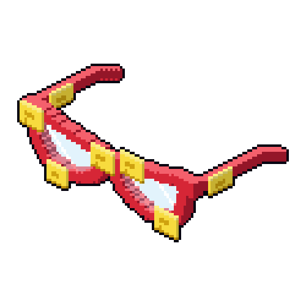

  

<h1 align="center">Hi, I'm Bon Varlet</h1>

M.S. Computer Science student at Georgia Tech (expected December 2027), focused on **embedded systems** and **cybersecurity**. I have a background in research and government-facing work.

I build hands-on hardware and security projects, and I document them as I go.

---

## B-Together

**B-Together** is the umbrella project for a growing family of retro-styled devices and tools for portable security work. Each piece lives in its own repo, and together they make one system: a command center, a mobile companion, and the software that runs on both.

*hardware, working to B-together.*

I keep adding new tools and upgrades, so every repo below is a living project.

  
  &nbsp;&nbsp;&nbsp;&nbsp;
  

| Project | What it is | Status |
|---|---|---|
| [**Bon-intosh**](https://github.com/BA-Varlet/Bon-intosh) | Raspberry Pi 5 in a Macintosh-style case: the command center | Building |
| [**B-rick**](https://github.com/BA-Varlet/B-rick) | DynaTAC-style mobile display and companion over Bluetooth | Planned |
| [**B.O.N. Software**](https://github.com/BA-Varlet/BON-Software) | Security tools and scripts for both devices | Planned |

## What I'm working on now

- Assembling the Bon-intosh and getting the base system running
- Writing the first tool: a Wi-Fi and Bluetooth recon scanner
- Researching parts for the B-rick

## What's next

- Bluetooth link between the Bon-intosh and the B-rick
- A self-hosted media server, hardened properly (VPN-only access, firewall, logging)
- More embedded projects that connect to the system

## Tools and interests

Python, C, Linux, Wireshark, Raspberry Pi, Arduino, embedded systems security, cybersecurity
<!-- add more later -->

## Get in touch

[LinkedIn](https://www.linkedin.com/in/bon-v-30a1871b3/) 
